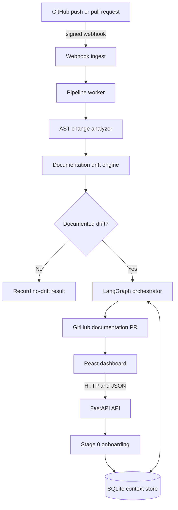

# DocRipple

> A self-updating documentation agent that detects code-to-documentation drift and opens focused GitHub pull requests.

DocRipple watches a GitHub repository, understands which symbols changed, finds the documentation sections that describe those symbols, and proposes a small documentation update. The important design choice is that the LLM is not the first step: deterministic parsing and matching decide whether a documentation change is needed before model tokens are spent.

## What problem does it solve?

Documentation becomes unreliable when code changes faster than its README and guides. A useful documentation bot must answer three questions before editing anything:

1. **What changed?** Identify functions, classes, routes, configuration, dependencies, and behavior from the diff.
2. **What documentation is affected?** Match changed symbols to Markdown anchors, code references, graph edges, and related sections.
3. **Is the proposed edit safe?** Verify the generated patch, review it against the repository's writing style, and publish it as a normal pull request.

DocRipple is built around those questions. If a change does not affect documented behavior, the pipeline exits without invoking the LLM.

## How it works



### The stages

| Stage | Name | What it does | LLM |
| --- | --- | --- | --- |
| 0 | Onboarding | Learns repository writing conventions and builds a code/documentation memory graph. | Optional |
| 1 | Ingest | Verifies the GitHub signature, deduplicates delivery IDs, and queues a job. | No |
| 2 | Change analysis | Parses the diff with Tree-sitter and classifies changed symbols. | No |
| 3 | Drift detection | Matches changed symbols to Markdown sections and graph relationships. | No |
| 4 | Orchestration | Plans, writes, verifies, reviews, and publishes a documentation patch. | Yes |
| 5 | Persistence | Stores run state, evidence, repository memory, and activity history. | No |

## Project layout

```text
DocRipple/
├── docsync-agent/       FastAPI backend and documentation pipeline
│   ├── src/
│   │   ├── main.py      Application wiring, lifespan, CORS, health
│   │   ├── onboarding/  Repository style and memory indexing
│   │   ├── ingest/      Signed GitHub webhook handling
│   │   ├── analyzer/    Diff and AST analysis
│   │   ├── drift/       Markdown matching and similarity fallback
│   │   ├── orchestrator/ LangGraph repair workflow
│   │   ├── context_store/ SQLite persistence
│   │   └── web_api/     Dashboard, auth, repository, and settings APIs
│   └── tests/           Backend unit and integration tests
├── frontend/            React and Vite dashboard
├── docs/                Architecture, API, deployment, and contributor docs
├── render.yaml          Render backend deployment blueprint
└── run.ps1              Local development helper for Windows
```

See the [documentation home](docs/README.md) for the full reading order.

## Run locally

### Prerequisites

- Python 3.11 or newer
- Node.js and npm
- A GitHub token for live repository operations
- An OpenRouter-compatible API key if you want to run the LLM stage

### Start the backend

```powershell
cd docsync-agent
py -3.11 -m venv .venv
.\.venv\Scripts\Activate.ps1
pip install -e ".[dev]"
Copy-Item .env.example .env
uvicorn src.main:app --reload --port 8000
```

The API is available at `http://localhost:8000`. Interactive API documentation is available at `/docs`.

### Start the frontend

In a second terminal:

```powershell
cd frontend
npm install
$env:VITE_API_BASE_URL="http://localhost:8000"
npm run dev
```

The dashboard is normally available at `http://localhost:5173`.

### Run the checks

```powershell
cd docsync-agent
.\.venv\Scripts\python.exe -m pytest -q
.\.venv\Scripts\python.exe -m ruff check src tests

cd ..\frontend
npm run build
npm run lint
```

## Configuration

Copy `docsync-agent/.env.example` to `docsync-agent/.env` and set the values needed for your environment:

| Variable | Purpose |
| --- | --- |
| `GITHUB_TOKEN` | Token used for repository reads, webhook installation, branches, commits, and pull requests. |
| `GITHUB_WEBHOOK_SECRET` | Shared secret used to validate `X-Hub-Signature-256`. |
| `PUBLIC_WEBHOOK_URL` | Public URL GitHub should call after a repository is connected. |
| `FRONTEND_URL` | Primary browser origin used for redirects and CORS. |
| `ALLOWED_ORIGINS` | Comma-separated additional browser origins. |
| `LLM_BASE_URL` | OpenAI-compatible provider endpoint; OpenRouter is the default. |
| `LLM_API_KEY` | Provider key used only by the orchestrator. |
| `LLM_MODEL` | Model used for planning, writing, and review. |
| `EMBEDDING_MODE` | `tfidf` by default; `fastembed` is an explicit opt-in. |
| `EXECUTION_MODE` | `inline` for serverless deployments, `queue` for a long-running worker. |
| `SQLITE_DB_PATH` | Context and activity database path. |

Never commit `.env`, GitHub tokens, OAuth secrets, or model-provider keys.

## Deployment

The repository is designed for a split deployment:

- **Frontend:** Vercel using the `frontend/` project.
- **Backend:** Render using [`render.yaml`](render.yaml).
- **Persistent external system:** GitHub for source, webhook events, and pull requests.

The default embedding mode is NumPy TF-IDF so the backend stays within the Render free-tier memory limit. SQLite uses `/tmp` in serverless or ephemeral environments; use durable storage if activity history must survive redeployments.

Read the [deployment guide](docs/deployment.md) before configuring production.

## Documentation

- [Documentation home](docs/README.md)
- [Architecture](docs/architecture.md)
- [Backend workflow](docs/backend.md)
- [Frontend](docs/frontend.md)
- [API reference](docs/api.md)
- [Data model](docs/data-model.md)
- [Deployment and operations](docs/deployment.md)
- [File structure](docs/filestructure.md)

## Contributing

Keep changes focused and update the documentation when behavior, routes, configuration, or deployment assumptions change. Before opening a pull request, run the backend tests and frontend build, then explain the affected pipeline stage in the PR description.

## License

No license file is currently included. Until one is added, treat the repository as source-available rather than automatically licensed for redistribution.
