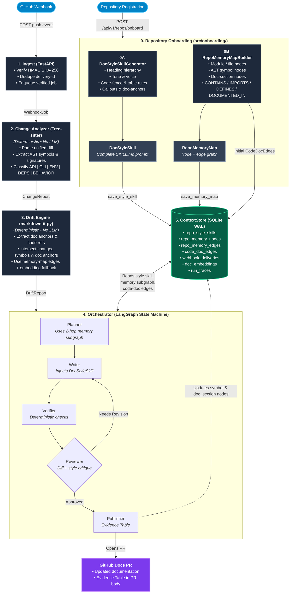

# Architecture

DocRipple runs a **Stage 0 onboarding** pass when a repository is registered, then processes each webhook through **Stages 1–5**. Stage 0 makes generated documentation repository-specific: it mines a writing-style skill and builds a hierarchical memory map before any diff is analyzed.

<details open>
<summary><b>Interactive Flowchart (Mermaid)</b></summary>



</details>

---

## Stage Overview

| Stage | Module | LLM? | Purpose |
| :--- | :--- | :--- | :--- |
| **0. Onboarding** | `src/onboarding/` | Optional style refinement only | Generate a repository DocStyleSkill and build the RepoMemoryMap before webhook processing begins. |
| **1. Ingest** | `src/ingest/` | No | Verify GitHub HMAC signatures, deduplicate deliveries, and enqueue jobs. |
| **2. Change Analyzer** | `src/analyzer/` | No | Parse diffs and extract/classify changed AST symbols. |
| **3. Drift Engine** | `src/drift/` | No | Match changed symbols to impacted Markdown sections; use memory-map graph edges and deterministic embeddings. |
| **4. Orchestrator** | `src/orchestrator/` | Yes | Plan, write, verify, review, and publish personalized documentation updates. |
| **5. ContextStore & Publish** | `src/context_store/` | No | Persist style skills, memory nodes/edges, code-doc edges, runs, and traces in SQLite WAL. |

---

## Component Breakdown

### 0. Repository Onboarding (`src/onboarding/`)
Runs once per registered repository — and again whenever the repository is re-indexed — before any webhook job is processed.

#### 0A. DocStyleSkillGenerator (`style_analyzer.py`)
Deterministically inspects `README.md` and `docs/**/*.md` to extract:

- **Heading hierarchy**: ATX levels used, dominant `## → ###` transitions, starting level, emoji/numbered headings, and common section names.
- **Code-block conventions**: language tags (`bash`, `python`, `json`, ...), `curl` examples, CLI flags, and typed/import-complete Python snippets.
- **Formatting conventions**: pipe tables, `> [!NOTE]`-style callouts, inline backticks, bullet lists, and `<!-- doc-anchor: ... -->` comments.
- **Tone and voice**: imperative/tutorial-first vs. declarative/reference-style, second-person usage, and average sentence density.

The result is a frozen `DocStyleSkill` whose `skill_markdown` is a complete `SKILL.md` instruction block:

```markdown
---
name: acme-billing-service-doc-style
description: Repository-specific documentation writing and structure rules...
---

# acme/billing-service Documentation Style Skill
## Tone and voice
...
## Heading conventions
...
## Code block conventions
...
## Formatting and anchors
...
```

The generator is fully offline by default. An optional `LLMClientProtocol` may refine the compiled block, but failures always fall back to the deterministic skill.

#### 0B. RepoMemoryMapBuilder (`memory_builder.py`)
Builds a node-and-edge graph in a thread-pool worker:

- **`Module` nodes** for directory packages, with hierarchical `CONTAINS` edges.
- **`File` nodes** for source files, connected to their parent module with `CONTAINS`.
- **`Symbol` nodes** for functions, classes, routes, CLI flags, environment variables, and config constants, connected with `DEFINES`.
- **`DocSection` nodes** from the drift engine's Markdown parser.
- **`IMPORTS` edges** between internal files/modules.
- **`DOCUMENTED_IN` edges** from symbols to the doc sections that mention them via explicit anchors, inline code, or heading names.

The same pass produces initial `CodeDocEdge` records and pre-populates `code_doc_edges`, so the first webhook already has a warm graph.

#### Onboarding API

| Method | Endpoint | Purpose |
| :--- | :--- | :--- |
| `POST` | `/api/v1/repos/onboard` | Accept inline `{repo_full_name, code_files, docs}` or fetch a snapshot from GitHub using `{repo_full_name, branch}`. |
| `GET` | `/api/v1/repos/{owner}/{repo}/skill` | Return the stored `DocStyleSkill`, including `skill_markdown`. |
| `GET` | `/api/v1/repos/{owner}/{repo}/memory` | Return the full `RepoMemoryMap`; pass `?symbols=foo,bar` for a 2-hop subgraph. |

### 1. Ingest (`src/ingest/`)
- **FastAPI Webhook**: Listens for push events (`POST /api/v1/webhooks/github`).
- **HMAC Verification**: Validates GitHub signatures using `GITHUB_WEBHOOK_SECRET`.
- **Deduplication**: Enforces idempotency using `X-GitHub-Delivery` recorded in `ContextStore`.
- **Enqueueing**: Hands off verified jobs for asynchronous background processing.

### 2. Change Analyzer (`src/analyzer/`) — *Deterministic (No LLM)*
- **Diff Parsing**: Analyzes incoming unified diffs without calling LLMs.
- **Tree-sitter AST Extraction**: Extracts symbol definitions and signatures (functions, classes, methods, routes, CLI flags, env vars).
- **Classification Engine**: Categorizes changes into `API_SURFACE`, `CLI`, `ENV_CONFIG`, `DEPS`, and `BEHAVIOR`.

### 3. Drift Engine (`src/drift/`) — *Deterministic (No LLM)*
- **Anchor Parsing**: Uses `markdown-it-py` to split documentation into sections and extract anchors.
- **Intersection Matching**: Computes `changed_symbols ∩ doc_anchors` with priority `exact_anchor` → `graph_edge` → `inline_symbol` → `embedding_fallback`.
- **Graph Warm Start**: `code_doc_edges` from Stage 0 power `graph_edge` matches on the very first diff.
- **Embedding Fallback**: Applies local fast embedding cosine similarity for unanchored sections.

### 4. Orchestrator (`src/orchestrator/`) — *LangGraph State Machine*
Before invoking the compiled graph, `OrchestratorService` loads:

- `doc_style_skill = await context_store.get_style_skill(repo_full_name)`
- `memory_subgraph = await context_store.get_memory_subgraph(repo_full_name, changed_symbol_names, max_hops=2)`

Both are placed into `OrchestratorState`. The graph then runs:

- **Planner**: Adds a formatted memory-map summary — parent modules, related symbols, and connected doc sections — to its planning prompt.
- **Writer**: Injects the full `DocStyleSkill.skill_markdown`, forcing headings, tone, code-fence languages, tables, callouts, and anchors to match the repository.
- **Verifier**: Performs deterministic checks on links, symbols, fences, and preserved anchors.
- **Reviewer**: Evaluates diff accuracy **and** DocStyleSkill adherence; loops back to the Writer when either fails.
- **Publisher**: Opens a GitHub PR with an Evidence Table, then updates the corresponding `symbol` and `doc_section` memory nodes.

Persistence is checkpointed via `AsyncSqliteSaver`.

### 5. ContextStore (`src/context_store/`) — *SQLite WAL*
Built on `aiosqlite` running in WAL mode.

| Table | Purpose |
| :--- | :--- |
| `repo_style_skills` | One frozen `DocStyleSkill` per repository, including the compiled `skill_markdown`. |
| `repo_memory_nodes` | Module, file, symbol, and doc-section nodes with deterministic summaries and JSON metadata. |
| `repo_memory_edges` | `CONTAINS`, `IMPORTS`, `DEFINES`, and `DOCUMENTED_IN` relationships. |
| `code_doc_edges` | Symbol-to-doc relationships pre-populated by Stage 0 and refreshed by the Publisher. |
| `webhook_deliveries` | Delivery ID idempotency registry. |
| `doc_embeddings` | Vector cache for doc sections. |
| `run_traces` | Execution history, publish results, and evidence. |

### Memory Subgraph Traversal
`get_memory_subgraph(repo_full_name, seed_symbols, max_hops=2)`:

1. Finds seed nodes by `name`, `path`, `node_id`, or symbol/anchor suffix.
2. Traverses `repo_memory_edges` in **both directions** for up to `max_hops`.
3. Returns only the induced nodes and edges, so Planner sees parent packages, sibling files/symbols, and linked documentation without loading the entire repository.
