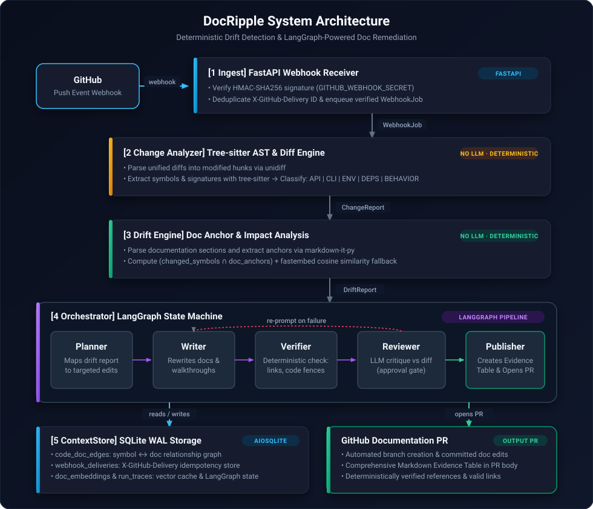
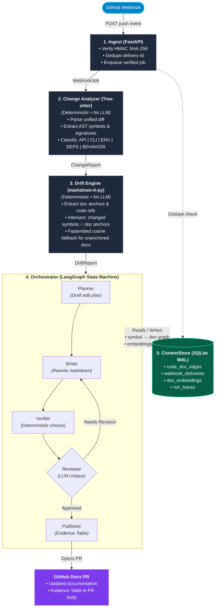

# Architecture

<b>Interactive Flowchart (Mermaid)</b>

---

## Component Breakdown

### 1. Ingest (`src/ingest/`)
- **FastAPI Webhook**: Listens for push events (`POST /api/v1/webhooks/github`).
- **HMAC Verification**: Validates GitHub signature using `GITHUB_WEBHOOK_SECRET`.
- **Deduplication**: Enforces idempotency using `X-GitHub-Delivery` recorded in `ContextStore`.
- **Enqueueing**: Hands off verified jobs for asynchronous background processing.

### 2. Change Analyzer (`src/analyzer/`) — *Deterministic (No LLM)*
- **Diff Parsing**: Analyzes incoming unified diffs without calling LLMs.
- **Tree-sitter AST Extraction**: Extracts symbol definitions and signatures (functions, classes, methods, routes, CLI flags, env vars).
- **Classification Engine**: Categorizes changes into semantic change classes:
  - `API_SURFACE`
  - `CLI`
  - `ENV_CONFIG`
  - `DEPS`
  - `BEHAVIOR`

### 3. Drift Engine (`src/drift/`) — *Deterministic (No LLM)*
- **Anchor Parsing**: Uses `markdown-it-py` to split documentation into sections and extract doc anchors.
- **Intersection Matching**: Computes `changed_symbols ∩ doc_anchors` to pinpoint impacted documentation sections.
- **Embedding Fallback**: Applies local fast embedding cosine similarity (`fastembed`) for documentation sections lacking explicit anchors.

### 4. Orchestrator (`src/orchestrator/`) — *LangGraph State Machine*
- **StateGraph Execution**: Orchestrates document updates across a multi-step workflow:
  - **Planner**: Maps `DriftReport` to a targeted edit plan.
  - **Writer**: Rewrites affected markdown sections and walkthroughs.
  - **Verifier**: Performs deterministic checks on links, symbols, and code fences.
  - **Reviewer**: Evaluates edits against the diff and loops back to Writer if criteria are not met.
  - **Publisher**: Opens a GitHub PR with an Evidence Table in the PR description.
- **Persistence**: Checkpointed via `AsyncSqliteSaver`.

### 5. ContextStore (`src/context_store/`) — *SQLite WAL*
- **Storage Layer**: Built on `aiosqlite` running in WAL mode.
- **Data Models**:
  - `code_doc_edges`: Symbol-to-doc relationship graph.
  - `webhook_deliveries`: Delivery ID idempotency registry.
  - `doc_embeddings`: Vector representations for doc sections.
  - `run_traces`: Execution history and agent runs.
